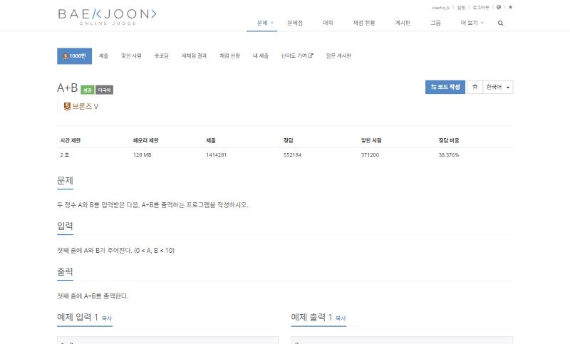
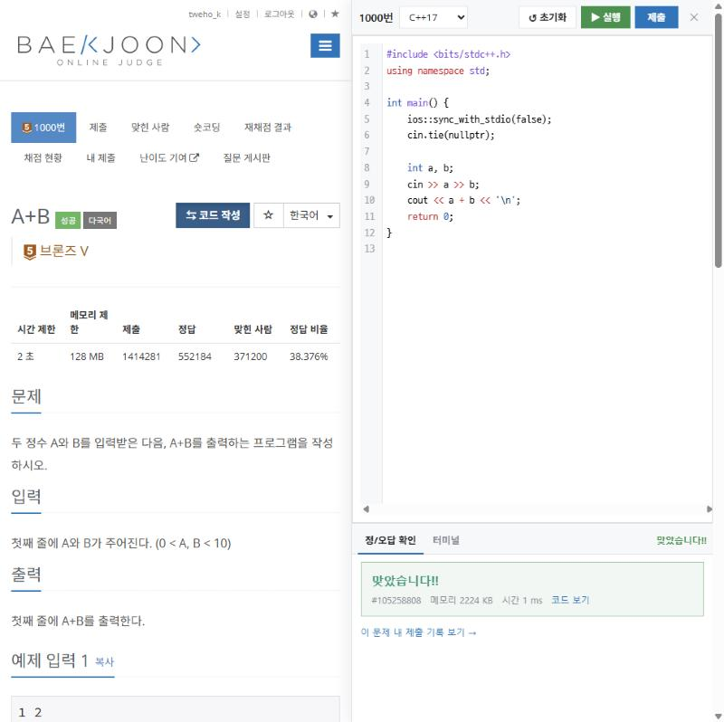

# Convenient_BOJ

백준(acmicpc.net) 문제 화면에서 **문제 읽기 → 코드 작성 → 실행 → 제출 → 정/오답 확인**을 한 화면에서 끝낼 수 있게 해 주는 크롬 확장 프로그램입니다.

```
┌──────────────┬──────────────────────────┐
│              │  코드 작성   [▶ 실행][제출] │
│     문제      ├──────────────────────────┤
│              │  정/오답 확인 | 터미널      │
└──────────────┴──────────────────────────┘
```


## 기능

### ⇆ 분할 화면 (문제 | 코드)
- 문제 페이지(`/problem/번호`)에서 제목 옆 **[⇆ 코드 작성]** 버튼이나 **Alt + C**로 엽니다.
- 왼쪽에는 원래 문제가 그대로 있고, 오른쪽에 코드 에디터와 결과 창이 붙습니다.
- 패널 왼쪽 경계와 에디터·결과 사이 경계를 끌어서 크기를 바꿀 수 있어요(크기는 기억돼요).
- 작성한 코드는 **문제·언어별로 자동 저장**돼서 다시 열어도 그대로 있어요.



### ▶ 실행: C / C++ / Python
- **실행**(Ctrl + Enter)을 누르면 결과 창이 **터미널**로 바뀌고, 문제의 **예제 입력으로 코드를 돌려 예제 출력과 비교**해요.
  - 틀린 예제는 입력 / 기대 출력 / 내 출력을 나란히 보여 줘요.
  - 컴파일 에러, 런타임 에러, stderr도 그대로 보여 줘요.
- 터미널 아래 칸에 원하는 입력을 넣고 **이 입력으로 실행**할 수도 있어요.
- 언어 목록은 백준 [언어 설정]에서 고른 언어를 따라요. C(C99/C11/…), C++(C++14/17/20/…, Clang 포함), Python 3 / PyPy3 를 지원해요.
- 컴파일 옵션: `-O2 -std=<언어 버전> -DONLINE_JUDGE` (C는 `-lm` 추가)

| 예제 통과 | 예제 틀림 | 컴파일 에러 (어두운 테마) |
| --- | --- | --- |
|  |  |  |

### 제출 → 정/오답 확인
1. 분할 화면(A)에서 **제출**(Ctrl + Shift + Enter)을 누르면 작은 백준 제출 창(B)이 열리고, **작성한 코드와 언어가 채워져 있어요.**
2. B에서 백준의 **[제출]** 버튼만 누르면 돼요.
   백준 제출에는 보안 확인(reCAPTCHA)이 있어서, 마지막 버튼은 사람이 직접 눌러야 해요.
3. 제출하자마자 **포커스가 A로 돌아와요.** B는 뒤에서 채점 현황을 지켜보고,
   A의 **정/오답 확인** 탭에 `채점 중 → 맞았습니다!!` 가 실시간으로 표시돼요.
4. 채점이 끝나면 **B는 자동으로 닫혀요.** 채점 전에 B를 직접 닫으면 A에 "제출 기록 열기" 안내가 떠요.

| 채워진 제출 창 | 분할 화면에 뜬 결과 |
| --- | --- |
|  |  |

- 메모리·시간·코드 보기 링크와 **이 문제 내 제출 기록** 링크를 함께 보여 줘요.
- 코드 공개 설정은 팝업에서 고를 수 있어요(기본값: 백준 설정을 따름).
- 제출 창이 열리지 않으면 주소창 오른쪽의 팝업 차단 아이콘에서 acmicpc.net 팝업을 허용해 주세요.

## 설치

1. [Releases](https://github.com/gaudium1257/Convenient_BOJ/releases/latest)에서 **Convenient_BOJ.zip** 을 내려받아 압축을 풉니다.
2. 크롬 주소창에 `chrome://extensions` 를 입력합니다.
3. 오른쪽 위 **개발자 모드**를 켭니다.
4. **압축해제된 확장 프로그램을 로드합니다** → 압축을 푼 `Convenient_BOJ` 폴더를 고릅니다.
5. 백준 문제 페이지를 새로고침하면 끝!

> 압축을 푼 폴더는 지우지 마세요. 크롬이 그 폴더에서 확장을 읽어요.

### 업데이트
새 ZIP을 받아 같은 폴더에 덮어쓴 뒤, `chrome://extensions` 에서 Convenient BOJ의 새로고침(↻)을 누르고 백준 탭도 새로고침해 주세요.

### 새 버전 배포하기 (개발자용)
`manifest.json` 의 `version` 을 올리고 같은 번호로 태그를 올리면, GitHub Actions가 ZIP을 만들어 Releases에 올려요.

```powershell
git tag v1.0.1; git push origin v1.0.1
```

## 단축키

| 키 | 동작 |
| --- | --- |
| Alt + C | 분할 화면 열기/닫기 |
| Ctrl + Enter | 예제로 실행 |
| Ctrl + Shift + Enter | 제출 창 열기 |
| Ctrl + S | 코드 저장 |

## 알아 두면 좋은 점

- **코드 실행은 외부 서버에서 해요.** 실행 버튼을 누르면 코드와 입력이 [Wandbox](https://wandbox.org)(공개 온라인 컴파일러)로 보내져요. 백준 채점 서버와 환경이 달라서 실행 시간은 참고만 해 주세요.
- **제출은 백준의 진짜 제출 페이지에서 해요.** 확장은 코드를 채워 주고 결과를 읽어 올 뿐, 비밀번호나 로그인 정보를 따로 다루지 않아요.
  백준은 스크립트로 보내는 요청에 빈 응답을 주기 때문에, 확장이 몰래 대신 제출하는 방식은 쓰지 않아요.
- 작성 중인 코드와 설정은 브라우저(`chrome.storage`) 안에만 저장돼요.

## 구조

```
manifest.json            확장 설정 (MV3)
background.js            코드 실행(Wandbox API), 제출 창 열기·포커스·닫기
content/split.js         분할 화면: 에디터, 실행 터미널, 제출 창 열기, 채점 결과 표시
content/split.css
content/submit.js        제출 페이지: 코드·언어 채우기 안내, 언어 목록 저장
content/submit-main.js   제출 페이지(페이지 world): 백준 에디터에 코드 넣기
content/status.js        채점 현황 페이지: A로 포커스 돌리기, 결과를 분할 화면으로 전달
popup/                   설정 팝업
shared/defaults.js       공통 기본 설정
shared/boj.js            채점 결과 읽기
vendor/codemirror/       CodeMirror 5 (MIT)
docs/screenshots/        실제 동작 캡처
dev/inject.js            개발용 테스트 로더 (확장에는 쓰이지 않음)
.github/workflows/       태그를 올리면 Releases에 ZIP 배포
```
