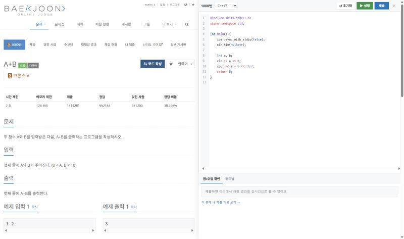
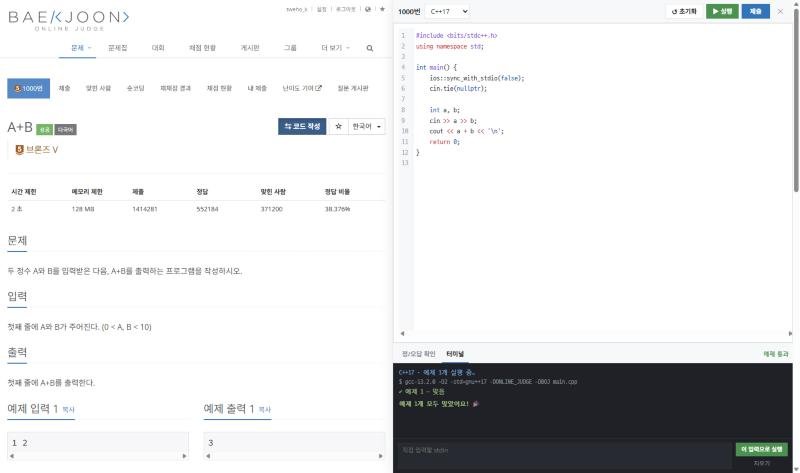
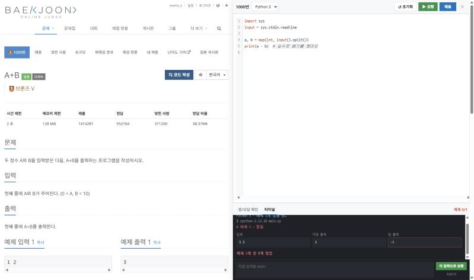
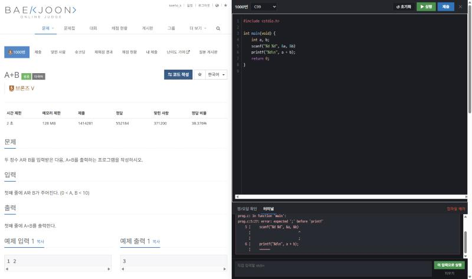
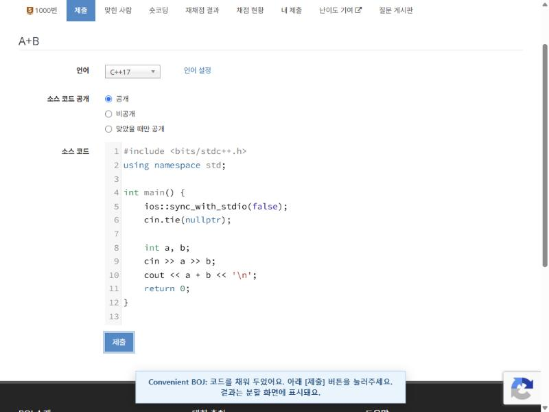

# Convenient BOJ

백준(acmicpc.net) 문제 화면에서 **문제 읽기 → 코드 작성 → 실행 → 제출 → 정/오답 확인**을 한 화면에서 끝내는 크롬 확장 프로그램이에요.

> 백준(BOJ)·스타트링크·데이원컴퍼니와 관련 없는 **비공식** 확장 프로그램이에요.



## 한눈에 보기

- **분할 화면**: 왼쪽은 문제 그대로, 오른쪽은 코드 에디터와 결과·터미널
- **6개 언어 실행**: C, C++, Java, Rust, Python 3, PyPy3. 예제와 나만의 테스트케이스로 채점하고, 틀리면 어느 줄이 다른지 보여 줘요
- **백준과 같은 환경**: 컴파일 옵션과 컴파일러 버전을 백준에 맞춰서, 여기서 되는데 백준에서 안 되는 일을 줄여요
- **진짜 터미널 (선택)**: 내 PC 실행 도우미를 설치하면 VS Code처럼 실행 중에 입력을 주고받아요
- **제출과 결과**: 백준의 공식 제출 페이지에 코드를 채워 주고, 채점 결과를 분할 화면에 실시간으로 보여 줘요
- **VS Code 같은 편집**: 자동완성, 엔터 자동 들여쓰기, 탭/공백 구분, 언어별 기본 코드, 풀이 타이머, 자동 저장

## 설치

### 크롬 웹 스토어
준비 중이에요. 등록되면 여기에 링크를 올릴게요.

### ZIP으로 직접 설치
1. [Releases](https://github.com/gaudium1257/Convenient_BOJ/releases/latest)에서 **Convenient_BOJ.zip** 을 내려받아 압축을 풀어요.
2. 크롬 주소창에 `chrome://extensions` 를 입력하고, 오른쪽 위 **개발자 모드**를 켜요.
3. **압축해제된 확장 프로그램을 로드합니다** → 압축을 푼 `Convenient_BOJ` 폴더를 골라요.
4. 백준 문제 페이지를 새로고침하면 끝!

> 압축을 푼 폴더는 지우지 마세요. 크롬이 그 폴더에서 확장을 읽어요.

여기까지만 해도 모든 기능을 쓸 수 있어요. 코드 실행은 온라인 컴파일러 [Wandbox](https://wandbox.org)에서 해요.

### 업데이트
새 ZIP을 받아 **같은 폴더에 덮어쓴 뒤**, `chrome://extensions` 에서 Convenient BOJ의 새로고침(↻)을 누르고 백준 탭도 새로고침해 주세요. 작성하던 코드와 설정은 그대로 남아요.
내 PC 실행 도우미를 쓰고 있다면 `host\install.bat` 도 다시 실행해 주세요. (이미 설치된 것은 건너뛰고 새로 생긴 것만 물어봐요)

<a id="2단계-내-pc에서-실행-진짜-터미널-선택"></a>

## 내 PC 실행 도우미 (선택, Windows)

코드를 **내 PC에서** 컴파일·실행하고, VS Code처럼 실행 중에 입력을 주고받는 **진짜 터미널**을 쓰고 싶을 때 설치해요. 설치하지 않으면 지금처럼 Wandbox에서 실행돼요.

1. 도우미 파일을 준비해요.
   - **ZIP으로 설치했다면**: 압축을 푼 폴더 안의 `host` 폴더를 쓰면 돼요.
   - **웹 스토어로 설치했다면**: 팝업의 **[도우미 받기]**를 누르거나 [Convenient_BOJ-helper.zip](https://github.com/gaudium1257/Convenient_BOJ/releases/latest/download/Convenient_BOJ-helper.zip) 을 받아 압축을 풀어요.
2. **`install.bat`** 을 더블클릭하고 묻는 대로 답해요. (모두 Enter = 예, 안 쓰는 언어는 n)
   - Python: 도우미가 Python으로 동작해서 꼭 필요해요
   - PyPy 3.11 (약 100MB): PyPy3로 풀 때
   - C/C++ 컴파일러 WinLibs gcc/g++ (약 250MB)
   - Java Temurin JDK 21 (약 200MB)
   - Rust GNU 판 (약 300MB, Visual Studio 없이 바로 컴파일돼요)
3. 백준 문제 탭을 새로고침하면 터미널 탭 오른쪽 위가 **● 내 PC** 로 바뀌어요.

- 관리자 권한은 필요 없어요. 도우미는 `%LOCALAPPDATA%\ConvenientBOJ` 에 설치되고 크롬·엣지·웨일에 등록돼요.
- 지우려면 `uninstall.bat` 을 실행해요. (Python·PyPy·gcc·JDK·Rust는 지우지 않아요)
- 도우미가 없는 언어는 자동으로 Wandbox에서 실행돼요. 팝업에서 언어별로 설치 여부를 볼 수 있어요.

## 사용법

### 분할 화면과 코드 작성
- 문제 페이지(`/problem/번호`)에서 제목 옆 **[⇆ 코드 작성]** 버튼이나 **Alt + C**로 열어요. 팝업에서 "바로 펼치기"를 켤 수도 있어요.
- 패널 경계를 끌어서 크기를 바꿀 수 있어요. 크기는 기억돼요.
- 작성한 코드는 **문제·언어별로 자동 저장**되고, 다시 열면 마지막으로 작업하던 위치로 돌아가요.
- **기본 코드**는 팝업에서 언어별로 바꿀 수 있어요. `$0` 자리에 커서가 놓여요(처음 열 때와 [↺ 초기화] 때만).

  | 언어 | 기본 코드 |
  | --- | --- |
  | C++ | 백준 권장 빠른 입출력(`ios::sync_with_stdio(false); cin.tie(nullptr);`) |
  | C | `stdio.h` + `main` 뼈대 |
  | Java | 백준 규칙 `public class Main` + `BufferedReader` 빠른 입력 |
  | Rust | 입력을 한 번에 읽어 `split_ascii_whitespace`, `BufWriter`로 출력 |
  | Python 3 / PyPy3 | 비어 있음 (필요하면 `input = sys.stdin.readline` 등을 추가) |

- **들여쓰기**: 팝업에서 **탭**(기본) 또는 **공백 4칸**을 골라요. 어느 쪽이든 Backspace 한 번에 한 단계씩 지워지고, 탭은 옅은 세로선으로 보여요.
- **엔터 자동 들여쓰기는 VS Code 규칙**을 따라요.
  - C/C++/Java/Rust: 닫히지 않은 `{`·`(` 로 끝나는 줄, `case 1:`·`default:` 다음은 한 단계 들여쓰기
  - Python: `:`로 끝나는 줄과 열린 괄호 다음은 들여쓰기, `return`/`pass`/`break`/`continue`/`raise` 다음은 내어쓰기
  - 괄호 쌍 사이(`{|}`)에서 엔터를 누르면 가운데 줄을 만들어요
- **자동완성**: 커서 아래에 후보 목록이 떠요. ↑↓로 고르고 Enter/Tab으로 넣어요.
  - 이름을 두 글자 치거나, 점(`.`)·`->`·`::` 를 치면 바로 떠요 (`v.` → `push_back`, `size` … / `std::` → `vector`, `string` …)
  - 점 뒤에는 `int`·`public` 같은 예약어를 빼고, 많이 쓰는 멤버부터 보여 줘요
  - 내 코드에 쓴 이름이 먼저 나오고, 글자를 건너뛰어도 찾아요 (`pb` → `push_back`)
  - Ctrl+Space로 언제든 열 수 있고, 팝업에서 끌 수 있어요. 타입을 분석하지는 않아요
- **풀이 타이머**: 툴바의 ⏱ 로 시작/일시정지, ↺ 로 초기화. **맞았습니다!!** 를 받으면 멈추고 풀이 시간을 보여 줘요.


### 실행
- **실행**(Ctrl + Enter)을 누르면 **예제 + 나만의 테스트케이스**로 코드를 돌려 기대 출력과 비교해요.
  - 틀리면 **몇 번째 줄부터 다른지**, 줄 수가 모자란지·남는지, 공백만 다른지 알려 주고 다른 줄을 강조해요.
  - 컴파일 에러, 런타임 에러, 시간 초과, stderr도 그대로 보여 줘요.
- **나만의 테스트케이스**: **테스트케이스** 탭에 문제마다 입력·기대 출력을 저장해 두면 실행할 때마다 같이 채점돼요. 기대 출력을 비우면 출력만 보여 줘요.
- **직접 입력으로 실행**: 터미널 아래 칸에서 실행해요.
  - 도우미가 있으면 **VS Code 터미널처럼** 실행 중에 입력하고 Enter를 치면 바로 전달돼요. Ctrl+C 중지, Ctrl+D 입력 끝.
  - 없으면 입력을 미리 적고 **이 입력으로 실행**을 누르면 끝난 뒤 결과를 한꺼번에 보여 줘요.
- 터미널 탭 오른쪽 위에 **실행 위치**(● 내 PC / ● Wandbox)가 보여요.
- 언어 목록은 백준 [언어 설정]에서 고른 언어를 따라요. PyPy3를 고르면 실행도 PyPy로 해요(코드는 Python 3와 같이 써요).

#### 백준과 같은 환경
최신 컴파일러로 실행하면 백준에 없는 문법·함수가 여기서만 통과할 수 있어서, **옵션과 버전을 백준에 맞췄어요.**

| 언어 | 백준 | Wandbox (도우미 없을 때) | 내 PC 도우미 |
| --- | --- | --- | --- |
| C / C++ | gcc 11.1, `-O2 -std=<버전> -DONLINE_JUDGE` (C는 `-lm`) | gcc 11.4 (C++23/26은 최신 gcc), clang 14 | 설치된 gcc, 같은 옵션 |
| Java | `javac -release 11`, `java -Xss512m` | JDK 22 + `--release 11` | 설치된 JDK + `--release 11` |
| Rust | rustc 1.90, `--edition <에디션> -O` | rust 1.90 | 설치된 rustc, 같은 옵션 |
| Python 3 | 3.13 | cpython 3.13 | 설치된 Python |
| PyPy3 | PyPy 7.3 (Python 3.10) | pypy 3.10 | 설치된 PyPy |

- Java는 버전을 `--release` 로 맞춰서, JDK 17·21이 깔려 있어도 Java 12 이후에 생긴 API(`stream().toList()` 등)는 컴파일 에러가 나요. (Java 8을 고르면 `--release 8`)
- 내 PC에서는 윈도우 기본 스택(1MB)이 백준보다 훨씬 작아서, C/C++·Rust는 스택을 256MB로 키워 깊은 재귀도 백준처럼 돌아가요.
- 내 PC 실행은 설치된 버전을 그대로 써요. 터미널 첫 줄에 쓰인 버전을 확인해 주세요. 어느 쪽이든 실행 시간은 참고만 해 주세요.
- Wandbox가 바쁘거나 잠깐 끊기면 자동으로 다시 시도해요. 오래 안 쓴 컴파일러는 첫 실행이 40초 넘게 걸리기도 해요.

| 예제 통과 | 예제 틀림 | 컴파일 에러 (어두운 테마) |
| --- | --- | --- |
|  |  |  |

### 제출 → 정/오답 확인
1. 분할 화면(A)에서 **제출**(Ctrl + Shift + Enter)을 누르면 같은 창 바로 옆에 백준 제출 탭(B)이 열리고, **작성한 코드와 언어가 채워져 있어요.**
2. B에서 백준의 **[제출]** 버튼을 직접 눌러요. (백준은 reCAPTCHA가 있고, 이용 규칙상 사람이 직접 눌러야 해요)
3. 제출하자마자 **A로 돌아오고**, A의 **정/오답 확인** 탭에 `채점 중 → 맞았습니다!!` 가 실시간으로 표시돼요.
4. 채점이 끝나면 **B는 자동으로 닫혀요.**

| 채워진 제출 탭 | 분할 화면에 뜬 결과 |
| --- | --- |
|  |  |

- 메모리·시간·코드 보기 링크와 **이 문제 내 제출 기록** 링크를 함께 보여 줘요.
- 코드 공개 설정은 팝업에서 고를 수 있어요(기본값: 백준 설정을 따름).

### 단축키

| 키 | 동작 |
| --- | --- |
| Alt + C | 분할 화면 열기/닫기 |
| Ctrl + Enter | 예제로 실행 |
| Ctrl + Shift + Enter | 제출 탭 열기 |
| Ctrl + S | 코드 저장 |
| Ctrl + Space | 자동완성 열기 |

## 개인정보와 백준 이용 규칙

- 개발자는 **어떤 정보도 수집하지 않아요.** 작성한 코드와 설정은 브라우저(`chrome.storage`) 안에만 저장돼요.
- 도우미 없이 실행하면 **코드와 입력이 Wandbox로 보내져요.** 자세한 내용은 [개인정보처리방침](PRIVACY.md)을 봐 주세요.
- 백준 [이용 규칙](https://help.acmicpc.net/rule)은 공식 `/submit` 페이지에서 사용자가 직접 제출 버튼을 누르지 않는 **자동 제출 도구**를 금지해요. 이 확장은 공식 제출 페이지에 코드만 채우고, 제출 버튼은 항상 사용자가 눌러요. 비밀번호나 로그인 정보도 다루지 않아요.

## 개발

### 구조
```
manifest.json            확장 설정 (MV3)
background.js            코드 실행(Wandbox API), 내 PC 도우미 연결, 제출 탭 열기·포커스·닫기
content/split.js         분할 화면: 에디터, 자동완성, 실행 터미널, 테스트케이스, 타이머, 채점 결과 표시
content/split.css
content/submit.js        제출 페이지: 코드·언어 채우기 안내, 언어 목록 저장
content/submit-main.js   제출 페이지(페이지 world): 백준 에디터에 코드 넣기
content/status.js        채점 현황 페이지: A로 포커스 돌리기, 결과를 분할 화면으로 전달
shared/boj.js            백준 페이지 선택자 모음, 채점 결과 읽기
shared/defaults.js       공통 기본 설정, 언어별 기본 코드
popup/                   설정 팝업
host/                    내 PC 실행 도우미(cboj_host.py)와 설치·제거 스크립트
vendor/codemirror/       CodeMirror 5 (MIT)
tests/e2e/               실제 크롬 + 진짜 백준 페이지 E2E 테스트
.github/workflows/       태그를 올리면 Releases에 ZIP 배포
```

### E2E 테스트
실제 크롬에 확장을 설치하고 **진짜 백준 문제 페이지**에서 사용자처럼 클릭·입력해 처음부터 끝까지 확인해요. (Node.js, 크롬 필요)

```
cd tests/e2e
npm install
npm test                 # 두 가지 모두
npm run test:helper      # 저장소 그대로 설치 → 이 PC의 실행 도우미로 실행
npm run test:store       # 웹 스토어 ZIP처럼 key를 뺀 복사본 → 도우미 없이 Wandbox로 실행
```

- 확인하는 것: 분할 화면, 언어 목록, 기본 코드·커서, 6개 언어 예제 실행(실행 위치와 백준 옵션 포함), 틀린 답 비교, 컴파일 에러, 나만의 테스트케이스, 터미널 실시간 입력, 자동완성, 엔터 들여쓰기, 타이머, 새로고침 후 코드 유지, 제출 버튼, 팝업
- 크롬 위치가 다르면 `CHROME` 환경 변수로, 화면을 보면서 하려면 `HEADFUL=1` 로 실행해요. 결과와 스크린샷은 `tests/e2e/out/` 에 남아요.
- 로그인이 필요한 실제 제출은 reCAPTCHA가 있어 자동화하지 않아요. 사람이 직접 확인해요.

### 새 버전 배포하기
`manifest.json` 의 `version` 을 올리고 같은 번호로 태그를 올리면, GitHub Actions가 ZIP을 만들어 Releases에 올려요.

```powershell
git tag v1.0.1; git push origin v1.0.1
```

| 파일 | 용도 |
| --- | --- |
| `Convenient_BOJ.zip` | 직접 설치용 (확장 ID를 고정하는 `key`와 도우미 포함) |
| `Convenient_BOJ-helper.zip` | 도우미만 (웹 스토어 사용자용, 팝업의 [도우미 받기]가 받는 파일) |
| `Convenient_BOJ-webstore.zip` | 크롬 웹 스토어 업로드용 (`key`와 도우미 제외) |

웹 스토어에 처음 올리면 스토어가 새 확장 ID를 줘요. 그 ID를 `host/install.ps1` 의 `$ExtensionIds` 에 추가하고 새 버전을 배포해야 스토어 버전도 내 PC 실행 도우미에 연결돼요.

## 라이선스

[MIT](LICENSE) © gaudium1257

- 코드 에디터로 [CodeMirror 5](https://codemirror.net/5/)(MIT)를 써요. 라이선스는 `vendor/codemirror/LICENSE` 에 있어요.
